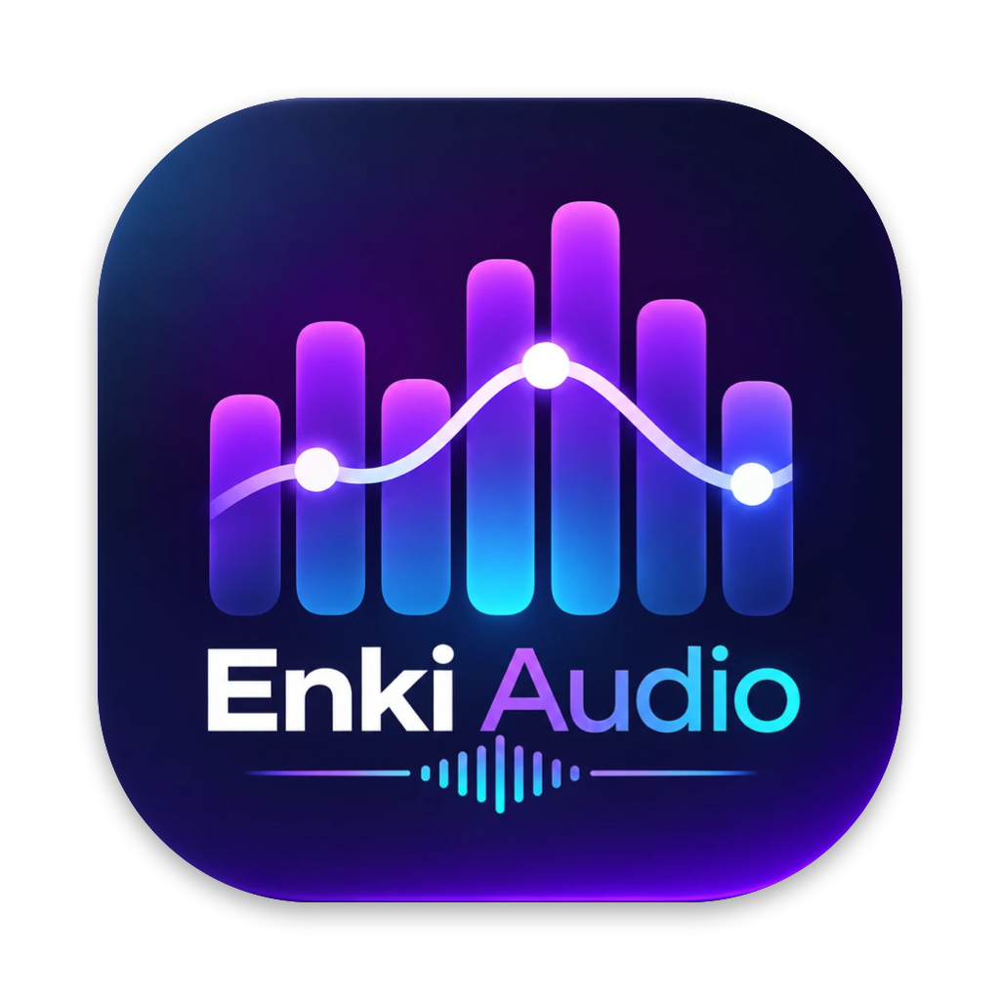

<p align="center"></p>

# Égaliseur

Égaliseur graphique et paramétrique pour **tout le son du Mac** (musique, vidéos, jeux, visioconférences), dans la barre des menus. Aucun pilote à installer : l'app utilise la capture audio intégrée à macOS.

## Installation

1. Téléchargez `Egaliseur-<version>.dmg` depuis la page [Releases](https://github.com/claudeLimonin/Enki/releases/latest).
2. Ouvrez-le et glissez **Egaliseur** sur le raccourci **Applications**.
3. Au premier lancement, macOS bloque l'app (elle ne vient pas de l'App Store) : Réglages Système → Confidentialité et sécurité → **Ouvrir quand même**.
4. Acceptez l'autorisation de capter l'audio du système (demandée une seule fois).

Configuration requise : macOS 14.2 ou plus récent, Mac Apple Silicon ou Intel.
Les mises à jour sont ensuite proposées automatiquement par l'app.

## Fonctionnalités

- Égaliseur **graphique** 10 bandes (compensé : les curseurs donnent exactement le gain affiché) ou **paramétrique** (bandes libres : cloche, plateau grave, plateau aigu).
- **Correction de casque** : plus de 8 000 profils [AutoEQ](https://github.com/jaakkopasanen/AutoEq), recherche par nom.
- **Réglage par application** (ex. « Voix » pour les visioconférences) et **par sortie audio** (casque, haut-parleurs…).
- **Écoute** : volume nivelé (mode nuit), spatialisation casque, mono, balance, **test auditif** personnalisé.
- Limiteur anti-saturation, spectre en temps réel, préréglages personnels partageables (`.egpreset`).
- Raccourcis clavier globaux (⌃⌥⌘E, ⌃⌥⌘←/→, ⌃⌥⌘N), sauvegarde des réglages, ouverture au démarrage.
- Interface en français et en anglais, guide interactif au premier lancement.

## Développement

```bash
./build.sh            # compile et signe build/Egaliseur.app
./package.sh          # image disque universelle dist/Egaliseur-<version>.dmg
./release.sh "Notes"  # publie la version sur GitHub (après avoir augmenté le numéro dans Resources/Info.plist)
```

Code en Swift (SwiftUI + Core Audio), sans dépendance externe. Signature ad hoc à identité stable (`sign.sh`) : aucun certificat ni trousseau nécessaire.

---

© 2026 Claude Limonin
